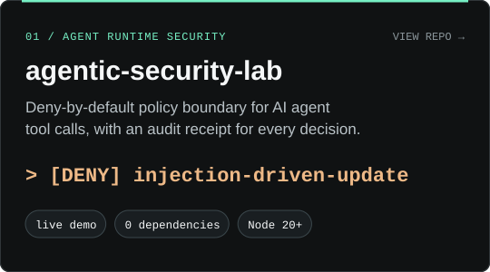
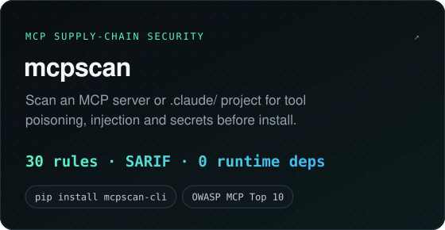
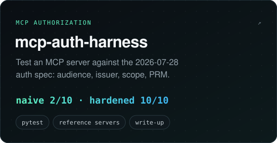
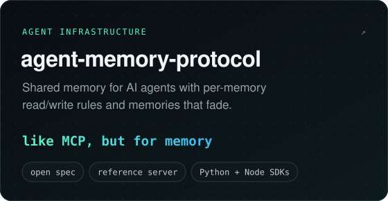
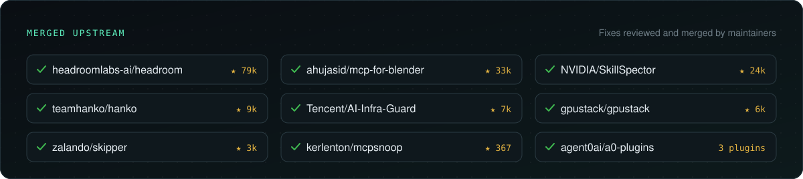

  

  <a href="https://www.kielltampubolon.id">Portfolio</a> &nbsp;/&nbsp;
  <a href="https://www.kielltampubolon.id/writing/">Writing</a> &nbsp;/&nbsp;
  <a href="https://www.linkedin.com/in/kiel-tampubolon/">LinkedIn</a> &nbsp;/&nbsp;
  <a href="https://dev.to/kielltampubolon">DEV.to</a> &nbsp;/&nbsp;
  <a href="https://kielltampubolon.medium.com">Medium</a>

<!-- DEVTO-FOLLOWERS-COUNT:START -->

<!-- DEVTO-FOLLOWERS-COUNT:END -->

## Projects

  
  
  
  

<b>More projects</b>

| Project | What it does |
| :--- | :--- |
| **[mcp-security-preflight](https://github.com/glatinone/mcp-security-preflight)** | Local MCP preflight scanner for unsafe commands, broad permissions and secret-like values. |
| **[browser-os](https://github.com/glatinone/browser-os)** | AI-native browser runtime: compact semantic observations, cheapest-mechanism action routing. |
| **[secops-toolkit-mcp](https://github.com/glatinone/secops-toolkit-mcp)** | Defensive utilities for analysts and agents: IOC handling, hashing, CIDR and command checks. |
| **[human-approval-gate](https://github.com/glatinone/human-approval-gate)** | Agent Zero plugin that pauses high-risk actions for human approval (merged into a0-plugins). |
| **[BraveMCP](https://github.com/glatinone/BraveMCP)** | Local-first MCP server that gives Claude Desktop searchable memory of browsing history. |
| **[streamblind-poc](https://github.com/glatinone/streamblind-poc)** | PoC and fix for telemetry blindness and state desync in AI streaming clients. |
| **[vulnscan](https://github.com/glatinone/vulnscan)** | OSV.dev lookups across 7 ecosystems with LLM exploitability analysis. |
| **[sentinelscout](https://github.com/glatinone/sentinelscout)** | Multi-source OSINT aggregator: VirusTotal, OTX, Shodan, NVD. |
| **[sketch2sim](https://github.com/glatinone/sketch2sim)** | Napkin circuit to Wokwi simulation with Gemma 4 and a repairing validator (MLH Hacktoberfest). |
| **[autoreview](https://github.com/glatinone/autoreview)** | AI pull request review in the terminal, with multiple LLM providers. |
| **[jepret](https://github.com/glatinone/jepret)** | 300 KB screenshot and annotation tool for Windows in Rust, idles at 1.3 MB of RAM. |
| **[phising101-kiel](https://github.com/glatinone/phising101-kiel)** | Interactive deck from my Hacktiv8 webinar "Phishing 101: Jangan Jadi Korban!". |

## Merged Upstream

<b>What each fix was</b>

| Project | Contribution |
| :--- | :--- |
| [headroomlabs-ai/headroom #3100](https://github.com/headroomlabs-ai/headroom/pull/3100) | `--no-ccr-response-handling` flag to bypass response buffering in the proxy. |
| [ahujasid/mcp-for-blender #324](https://github.com/ahujasid/mcp-for-blender/pull/324) | Handle multi-byte UTF-8 sequences split across socket reads. |
| [NVIDIA/SkillSpector #381](https://github.com/NVIDIA/SkillSpector/pull/381) | Stop the code-example heuristic from silently dropping SKILL.md findings. |
| [teamhanko/hanko #2725](https://github.com/teamhanko/hanko/pull/2725) | Propagate context and fix a duplicate defer in the OAuth providers. |
| [Tencent/AI-Infra-Guard #541](https://github.com/Tencent/AI-Infra-Guard/pull/541) | Surface the underlying error when an MCP scan cannot connect. |
| [gpustack/gpustack #5817](https://github.com/gpustack/gpustack/pull/5817) | Propagate asyncio cancellation, remove mutable default arguments. |
| [zalando/skipper #4125](https://github.com/zalando/skipper/pull/4125) | Isolate the upgrade proxy dialer and give it a 30s timeout. |
| [kerlenton/mcpsnoop #40](https://github.com/kerlenton/mcpsnoop/pull/40) | Open sessions piped directly from stdin. |
| [agent0ai/a0-plugins](https://github.com/agent0ai/a0-plugins/pulls?q=is%3Apr+author%3Aglatinone+is%3Amerged) | Three plugins: human approval gate, chat jumper, chat status lights. |

In review: [NVIDIA/garak](https://github.com/NVIDIA/garak/pulls?q=is%3Apr+author%3Aglatinone+is%3Aopen), [BerriAI/litellm](https://github.com/BerriAI/litellm/pulls?q=is%3Apr+author%3Aglatinone+is%3Aopen), [paperclipai/paperclip](https://github.com/paperclipai/paperclip/pulls?q=is%3Apr+author%3Aglatinone+is%3Aopen), [rowboatlabs/rowboat](https://github.com/rowboatlabs/rowboat/pulls?q=is%3Apr+author%3Aglatinone+is%3Aopen), [Tencent/BrowserSkill](https://github.com/Tencent/BrowserSkill/pulls?q=is%3Apr+author%3Aglatinone+is%3Aopen).

## Writing

- [MCP Security: A Practitioner's Guide](https://www.kielltampubolon.id/writing/mcp-security-guide/)
- [I wrote an MCP server auth test harness for the 2026-07-28 spec](https://www.kielltampubolon.id/writing/i-wrote-an-mcp-server-auth-test-harness-for-the-2026-07-28-spec-here-is-what-broke-first/)
- [A fake MCP server spent three months earning trust. The tells were there](https://www.kielltampubolon.id/writing/a-fake-mcp-server-spent-three-months-earning-trust-the-tells-were-there/)

More articles

- [I scanned 30 Docker images. 10 still trust the root Chrome is dropping](https://www.kielltampubolon.id/writing/the-emudhra-fallout-part-2-i-scanned-30-docker-images-10-still-trust-the-root-chrome-is-dropping/)
- [What is MCP security? Common attacks and how to scan your MCP servers](https://www.kielltampubolon.id/writing/what-is-mcp-security-common-attacks-and-how-to-scan-your-mcp-servers/)
- [My AI agent said we were under attack. The logs said otherwise.](https://www.kielltampubolon.id/writing/my-ai-agent-said-we-were-under-attack-the-logs-said-otherwise/)
- [We planted 10 vulnerabilities to test free Semgrep. It reported 3.](https://www.kielltampubolon.id/writing/we-planted-10-vulnerabilities-to-test-free-semgrep-it-reported-3/)
- [The eMudhra CA keys were one byte long. Does your container still trust them?](https://www.kielltampubolon.id/writing/the-emudhra-ca-keys-were-one-byte-long-does-your-container-still-trust-them/)
- Everything else: [kielltampubolon.id/writing](https://www.kielltampubolon.id/writing/)

---

Implementation first. Evidence over hype. &nbsp;·&nbsp; Collaborations: <a href="https://www.linkedin.com/in/kiel-tampubolon/">LinkedIn</a> or <a href="https://www.kielltampubolon.id/sponsor/">sponsorships</a>.
